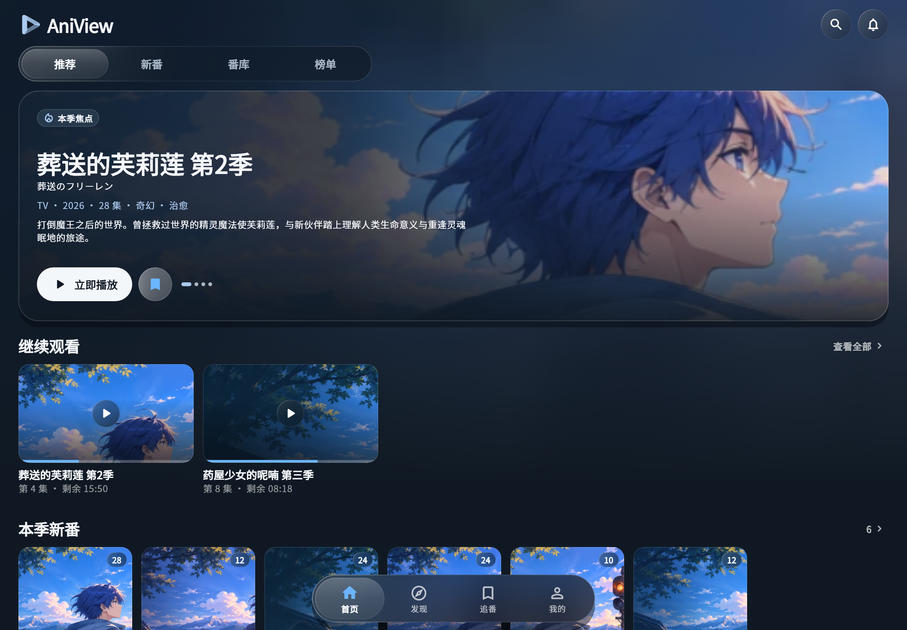
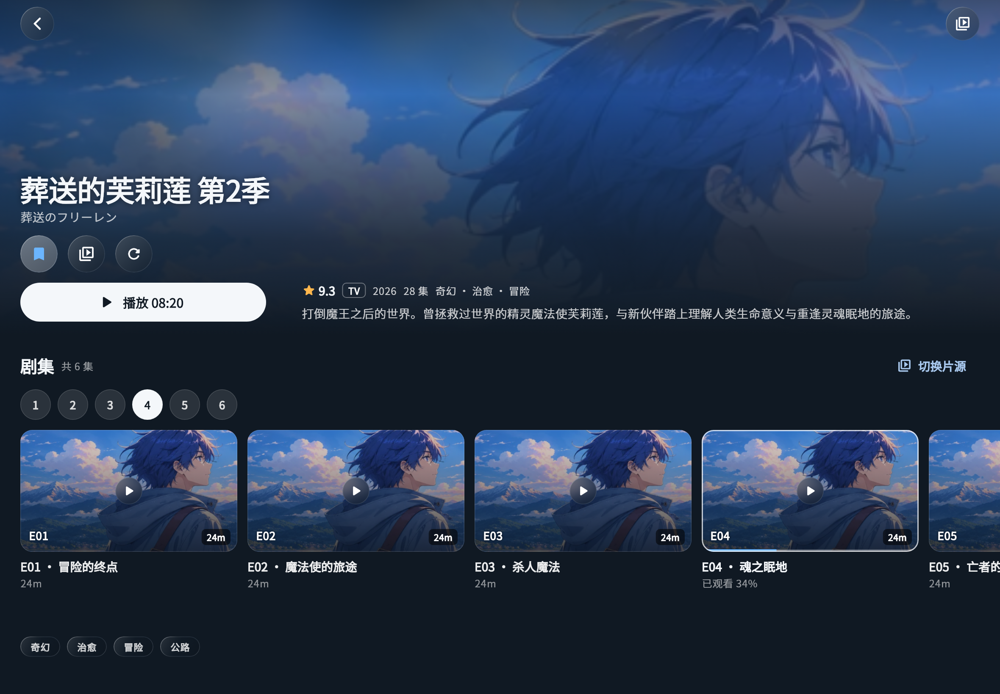
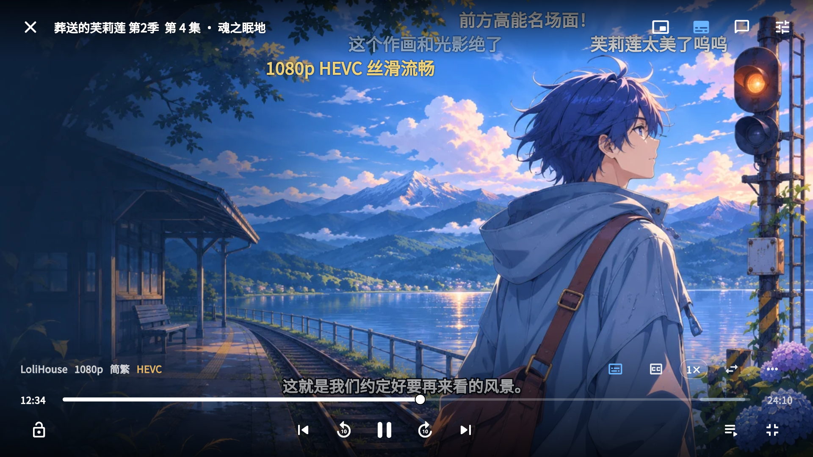
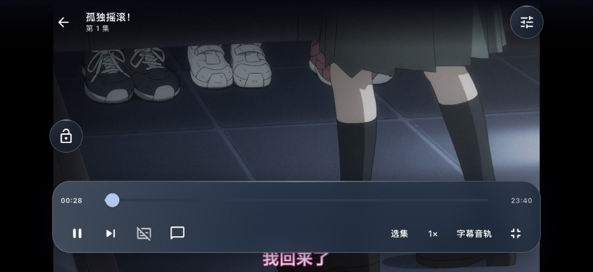
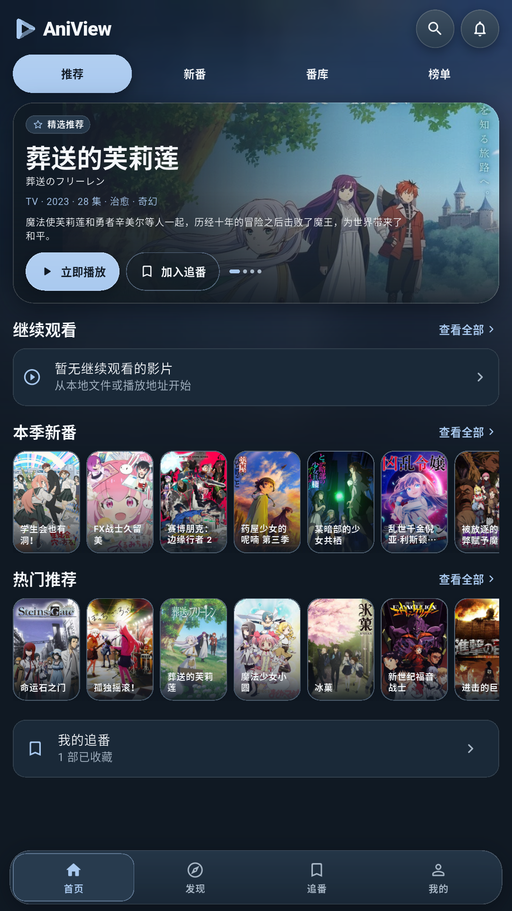
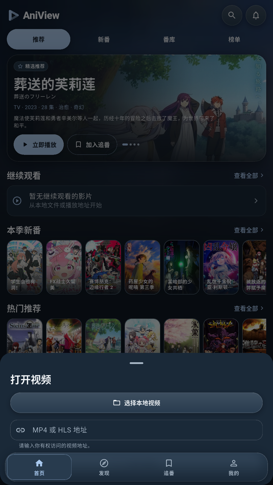

<div align="center">

# AniView

**本地优先的跨平台番剧追踪与个人媒体播放器 · A Local-First Anime Tracker & Personal Media Player**

[](https://github.com/morangse/aniview/releases/latest)
[](https://github.com/morangse/aniview/actions/workflows/ios-build.yml)
[](LICENSE)
[](https://flutter.dev)
[](#下载与安装)

</div>

**AniView** 是一款使用 Flutter 构建的开源跨平台番剧目录浏览、观看进度记录与个人媒体/弹幕播放器应用。应用遵循 **本地优先（Local-First）** 原则：观看进度、本地片源索引、字幕与弹幕附件完全保存在设备本地 SQLite 数据库中，个人凭据保存在系统安全密钥库，并支持按需与 Bangumi 双向同步收藏和观看状态。

> **开源声明**：AniView 仅作为个人媒体播放器与 Bangumi 条目管理工具使用，**不内置、不托管、不聚合或分发任何盗版视频资源或受版权保护的流媒体**。所有播放来源均由用户自行提供的本地文件、个人媒体库（Jellyfin / Emby）或自主配置的公开接口决定。

---

## 运行截图预览

### iPadOS / iOS — 光学液态玻璃交互与极简播放体验

<table>
  <tr>
    <td width="50%" align="center">
      <b>iPad 全出血首页与悬浮液态玻璃 Dock</b><br/>
      <sub>自适应宽屏海报书架 · 单层折射激活透镜</sub><br/><br/>
      
    </td>
    <td width="50%" align="center">
      <b>模糊封面沉浸详情页与 16:9 分集卡片</b><br/>
      <sub>圆形玻璃操作钮 · 分集高亮 · 进度条衔接</sub><br/><br/>
      
    </td>
  </tr>
  <tr>
    <td width="50%" align="center">
      <b>iOS 极简全屏播控与弹幕 / 字幕渲染</b><br/>
      <sub>片源解析标签 (Fansub · 分辨率 · 编码) · OP/ED 进度标记</sub><br/><br/>
      
    </td>
    <td width="50%" align="center">
      <b>真机实测弹幕播放效果</b><br/>
      <sub>真机硬件解码 + 滚动弹幕实时渲染</sub><br/><br/>
      
    </td>
  </tr>
</table>

### Android — 原生自适应深色界面

<table>
  <tr>
    <td width="50%" align="center">
      <b>Android 首页书架与悬浮胶囊导航</b><br/>
      <sub>Midnight Mist 深色质感 · 推荐 / 新番 / 番库 / 榜单</sub><br/><br/>
      
    </td>
    <td width="50%" align="center">
      <b>片源查找与本地视频接入面板</b><br/>
      <sub>SAF 持久化文件访问 · 直链与订阅片源匹配</sub><br/><br/>
      
    </td>
  </tr>
</table>

---

## 下载与安装

最新预编译安装包请在 [**GitHub Releases**](https://github.com/morangse/aniview/releases/latest) 页面下载：

| 平台 | 安装包文件 | 安装方式与系统要求 |
| --- | --- | --- |
| **Android (`arm64-v8a`)** | `AniView-v0.2.5-android-arm64.apk` | Android 7.0+（API 24+），直接安装 APK 即可 |
| **iOS / iPadOS (未签名)** | `AniView-v0.2.5-ios-unsigned.ipa` | iOS / iPadOS 15.0+，通过 AltStore、SideStore、Sideloadly 或 TrollStore 自签安装 |
| **校验文件** | `SHA256SUMS.txt` | 用于核对 APK 与 IPA 文件完整性 |

> **iOS / iPadOS 本地视频导入提示**：除通过系统文件选择器挑选视频外，也可以直接将视频、外挂字幕或弹幕放入「文件 App → 我的 iPhone / iPad → AniView → `AniViewMedia`」目录中即可访问。

---

## 核心功能特性

### 1. Bangumi 番剧目录与追番同步
- 浏览 **推荐焦点、本季新番、热门排行、全部番库**，支持中文名 / 原文名 / 别名检索、年份与标签筛选。
- 支持五类收藏状态（想看 / 在看 / 看过 / 搁置 / 抛弃）、评分、短评以及本地单集已看/播放秒数记忆。
- 支持通过 Bangumi 个人令牌（PAT）或可独立部署的 OAuth Worker 桥接（`oauth_worker`）进行安全同步。

### 2. 双端原生体验与自适应布局
- **iOS & iPadOS**：参考原生 iOS 26 光学质感设计的居中悬浮液态玻璃胶囊 Dock（无双层边框重叠、支持触感反馈）、全出血 iPad 海报网格、模糊封面详情页、极简渐变全屏播控层与直入播放页无缝选源。
- **Android**：专为 Android 手机与平板优化的 Material 3 Midnight Mist 界面，小屏使用悬浮胶囊底栏，大屏自动扩展双栏详情与剧院分栏播放模式，支持画中画（API 26+）与 SAF 持久化本地文件授权。

### 3. 智能剧集匹配（Matcher 2.0）与分番剧片源记忆
- **ReleaseTitleParser**：自动从发布标题中提取字幕组（Fansub）、双语片名、季度、正片/特别篇集数、修订版本号（`v2+`）、分辨率（`4K`/`1080p`/`720p`）、编码（`HEVC`/`AV1`/`AVC`）、简繁字幕标签与合集标识。
- **分番剧自动记忆**：某一集起播成功或确认片源后，自动记住该番剧的可用片源与字幕组偏好；下一集将通过快路径优先命中已记住片源并自动起播，失败时再自动回退查询其余已启用源。
- **直入播放页无缝选源（iOS / iPadOS）**：点按播放或分集时直接进入播放器原位查找片源，查找到结果后立即无缝起播，也可以在播放器内嵌的「片源选择」面板中单手切换线路。

### 4. 弹幕系统（Danmaku 2.0）
- **兼容弹弹play 开放协议的弹幕接口**：支持管理与排序多个弹幕服务器地址，支持剧集弹幕搜索及自定义 URL 拉取，兼容官方模式编号（含 `mode=0` 滚动弹幕）。
- **本地弹幕导入**：支持导入本地弹弹play JSON 与 Bilibili XML 格式弹幕文件。
- **实时调控与自发弹幕**：可实时调整不透明度、字号、弹幕速度、显示区域（20%–100%）、同屏上限、时间轴微调（±0.25s）、滚动/顶部/底部/彩色开关、关键词屏蔽，并可在播放器内直接发送本地持久化弹幕。

### 5. `media_kit` 播放内核与安全回环代理
- 基于 `media_kit`（`libmpv`）+ `libass`，支持硬解/软解切换、外挂 `SRT` / `WebVTT` / `ASS` / `SSA` 字幕与时间偏移、多音轨切换。
- 支持纵向滑动调节亮度 / 最高 **150% 软件音量增益**、横向滑动精细进度预览、长按 **2× 临时倍速**、OP/ED 片头片尾跳过标记、播完自动连播下一集倒计时。
- 内置短期本地回环转发代理 `PlaybackRelay`，为需要鉴权请求头的个人媒体服务器或自定义来源提供原站域隔离传输。

### 6. 用户自配片源与离线下载
- 支持本地视频选择、MP4/HLS 地址直连、**Jellyfin / Emby** 个人媒体库直连，以及自定义 JSON / RSS / Web 目录与 Animeko v2 订阅规则导入。
- 对明确标记授权离线（`offlineAllowed`）的来源提供支持 HTTP `Range` 与 ETag / Last-Modified 断点续传、SHA-256 校验与限速的离线下载任务管理。

---

## 模块架构

| 目录 | 职责 |
| --- | --- |
| `lib/app` | Riverpod 全局依赖容器、`go_router` 路由配置与导航外壳 |
| `lib/core/theme` & `lib/core/widgets` | Midnight Mist 色彩与动效 Token、光学液态玻璃组件、封面缓存 |
| `lib/features` | 首页、发现、详情、追番、历史、设置、片源管理与播放器界面 |
| `lib/data/bangumi` | Bangumi v0 公开目录、离线缓存与账号同步状态机 |
| `lib/media/sources` | 多源适配器、Matcher 2.0 解析器、自动记忆排序与 `PlaybackRelay` |
| `lib/media/overlays` | Danmaku 2.0 客户端与布局引擎、`SRT/VTT/ASS` 字幕解析 |
| `lib/media/downloads` | 断点续传与校验持久化下载器 |
| `lib/core/database` | Drift SQLite 表结构迁移与系统安全密钥库封装 |
| `oauth_worker` | 可自托管的 Bangumi OAuth 桥接 Cloudflare Worker 示例 |

更多技术细节请参阅：
- [架构与迁移说明](docs/ARCHITECTURE.md)
- [自定义片源与订阅目录规范](docs/AUTHORIZED_SOURCES.md)
- [测试与质量证据](docs/TESTING.md)

---

## 从源码构建

### 环境要求
- Flutter `>= 3.44.0`（当前 CI 与开发验证版本为 `3.47.0`）
- Dart `>= 3.13.0`
- **Android**：Android SDK（minSdk `24`、targetSdk `35`）、Java 17、Android NDK
- **iOS / iPadOS**：macOS + Xcode + CocoaPods（仓库自带 [.github/workflows/ios-build.yml](.github/workflows/ios-build.yml) 自动构建工作流）

### 构建步骤

```bash
# 1. 拉取依赖并生成 Drift 代码
flutter pub get
dart run build_runner build --delete-conflicting-outputs

# 2. 静态分析与全量测试
flutter analyze
flutter test

# 3. 构建 Android APK（arm64）
flutter build apk --release --target-platform android-arm64

# 4. 构建未签名 iOS 包（macOS 环境）
cd ios && pod install && cd ..
flutter build ios --release --no-codesign
```

---

## 隐私、合规与开源许可

- **隐私与凭据安全**：Bangumi Token、个人媒体服务器密码及自建直链 URL 统一存储于系统密钥库（Android Keystore / iOS Keychain），不随 SQLite 数据库外泄。
- **第三方资源与字体归属**：
  - 本仓库源代码依据 [**Apache License 2.0**](LICENSE) 开源。
  - 内置字幕兜底字体 [`assets/fonts/NotoSansSC-Regular.otf`](assets/fonts/NotoSansSC-Regular.otf) 遵循 **SIL Open Font License 1.1**（见 [`assets/licenses/OFL-1.1.txt`](assets/licenses/OFL-1.1.txt)）。
